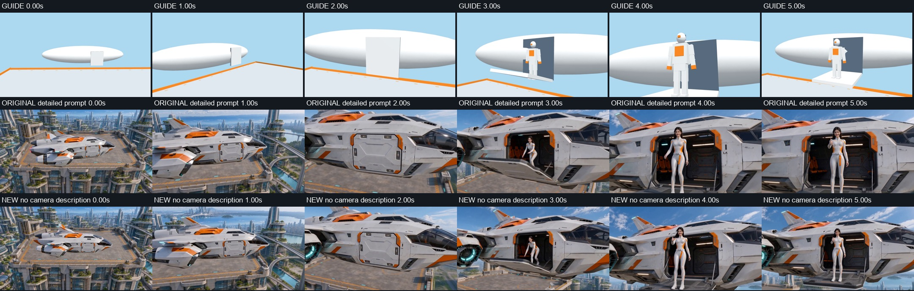

# Runnable example: short airship approach

This is the **tested short airship shot with specific camera descriptions removed**, not the earlier 360-degree orbit or the unsuccessful long jump shot. The rough guide approaches a hatch; Mia steps out and gives a thumbs-up. The included `result.mp4` is the actual unretimed generation from this test.



## Download and run

1. Download this repository using **Code → Download ZIP**, then extract it. Downloading only the workflow JSON does not include the media.
2. Copy the five files inside this example's `input/` directory directly into your actual **ComfyUI/input/** directory. Keep the filenames unchanged. Alternatively, from this example directory run:

   ```bash
   python install_inputs.py --comfy-root "/path/to/ComfyUI"
   ```

   The helper verifies SHA-256 hashes and refuses to overwrite a different existing file. It does not download models or submit a generation.
3. Open [workflow.json](workflow.json) in ComfyUI. The four image loaders and video loader should show the supplied media. If you installed the inputs after opening ComfyUI, refresh the page and reload the workflow, or reselect the files.
4. Install/select the H3 models below, then run. The example saves under `output/h3_examples/airship_guide/short_approach...`.

[API-format graph](api/workflow.api.json) · [Exact tested prompt](prompt.json) · [Actual generated output](result.mp4) · [Input/result checksums and settings](manifest.json) · [Validation record](validation.json)

## What each reference does

| Input | Responsibility |
| --- | --- |
| Picture 1: `taoofai_airship_short-mia-body.png` | Mia's identity, body, hair and white-orange outfit |
| Picture 2: `taoofai_airship_short-city.png` | Finished rooftop/city set design; not an instruction to copy this image's aerial viewpoint |
| Picture 3: `taoofai_airship_short-mia-face.png` | Mia's face identity |
| Picture 4: `taoofai_airship_short-airship.png` | Finished vehicle design and closed hatch appearance |
| Video 1: `taoofai_airship_short-guide.mp4` | Rough spatial arrangement, camera movement, ship/character root movement and hatch motion |

The guide existed before generation. It was not rebuilt to match the result. Its coarse mannequin is not a requested final costume or robot. Natural stepping and the thumbs-up are requested in text rather than fully animated in the guide.

## What was removed from the prompt

The test removes the explicit rear-three-quarter starting viewpoint, sweep along the hull, push-in, medium/waist-up framing and other specific camera directions. **Generic instructions to follow Video 1 remain.** The prompt still includes reference-role mappings, appearance details, forward flight, hatch mechanics, actor actions and their event times. This is a camera-description ablation, not an empty-prompt or video-only experiment.

All six prompt sections are embedded in the workflow and also supplied in `prompt.json`; do not replace it with the prompt from a different airship experiment.

## Result and limits

The tested result retains the broad approach toward the hatch. Late framing pulls back more than the historical detailed-camera-prompt result, revealing more of Mia and the ship. **Camera elevation, precise framing and projected positions still differ from the guide. This is not frame-exact camera control.**

This is one seed and one short scene. The historical comparison is not a fresh original-prompt rerun under the current runtime. A separate long car-interaction test lost close-ups and leaked the orange proxy after camera descriptions were removed, so this example is not evidence that every complex shot works with the same minimal camera instruction.

## Settings and dependencies

- H3 Ref2VA with Pika H3 Flex adapter, strength **1.0**.
- **1280 × 704**, **124 frames**, **24 fps**, approximately **5.17 seconds**.
- Seed **2026111919**, **LCM**, six sampling steps, sigma schedule `1.0, 0.972973, 0.923077, 0.8, 0.571429, 0.333333, 0.0`.
- Single clip: no Motion Context, ControlNet, voice refiner, extra layout image or previous latent cache is required.
- Tested on a local RTX 4090 setup with ComfyUI **0.38.0**; frontend import checked with **1.53.10**. These are tested versions, not established minimum requirements. Older ComfyUI builds may lack the native H3 nodes. Other hardware/software can change results and memory requirements.

Install the exact model files in the usual ComfyUI model directories, or select equivalent installed paths deliberately:

| ComfyUI directory | Model file |
| --- | --- |
| `models/diffusion_models/` | [minimax_h3_ref2va_pruned_int8_convrot.safetensors](https://huggingface.co/Comfy-Org/MiniMax-H3/resolve/main/diffusion_models/minimax_h3_ref2va_pruned_int8_convrot.safetensors) |
| `models/text_encoders/` | [qwen3vl_32b_minimax_h3_nvfp4_awq.safetensors](https://huggingface.co/Comfy-Org/MiniMax-H3/resolve/main/text_encoders/qwen3vl_32b_minimax_h3_nvfp4_awq.safetensors) |
| `models/vae/` | [minimax_h3_video_vae_fp16.safetensors](https://huggingface.co/Comfy-Org/MiniMax-H3/resolve/main/vae/minimax_h3_video_vae_fp16.safetensors) |
| `models/vae/` | [minimax_h3_audio_vae_fp32.safetensors](https://huggingface.co/Comfy-Org/MiniMax-H3/resolve/main/vae/minimax_h3_audio_vae_fp32.safetensors) |
| `models/loras/` | [pika_h3_flex_ref2va_v1_bf16.safetensors](https://huggingface.co/Comfy-Org/MiniMax-H3/resolve/main/loras/pika_h3_flex_ref2va_v1_bf16.safetensors) |

See the [official Pika H3 Flex project](https://github.com/Pika-Labs/Pika-H3-Flex) for model usage and licensing. The media are approximately **7.8 MB of inputs plus 4.9 MB of generated output**; model weights are separate and much larger. No model weights, private voice recordings or latent caches are bundled.

If media are missing, check that the files are in the **server's** input folder, not a separate frontend or another ComfyUI installation. If model names are unavailable, install the corresponding files and refresh the model lists. A missing native H3 node requires updating the matching ComfyUI installation. Import validation alone is not a guarantee of successful inference on another machine.
